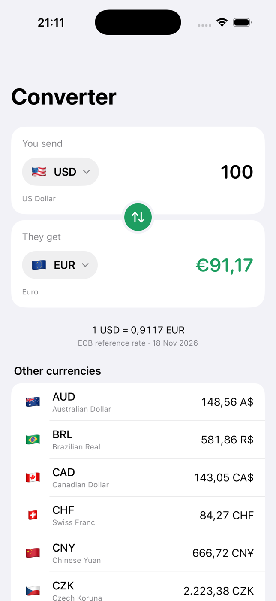
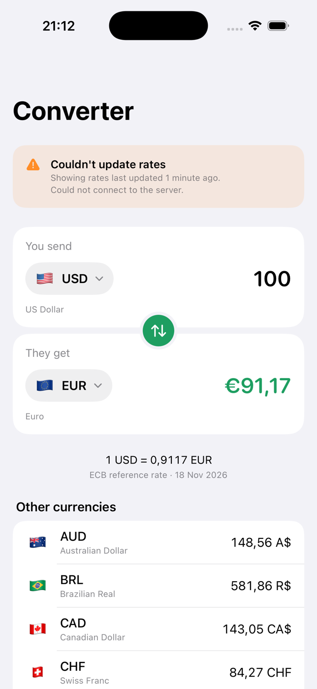
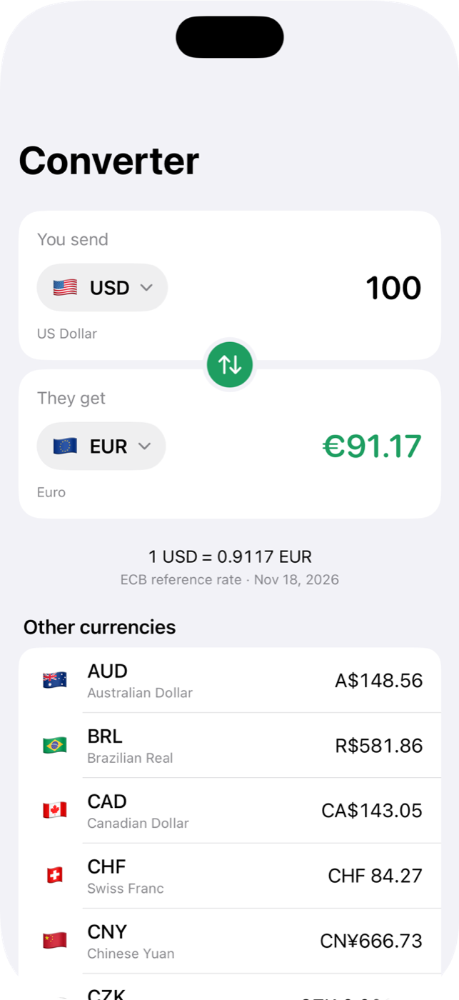
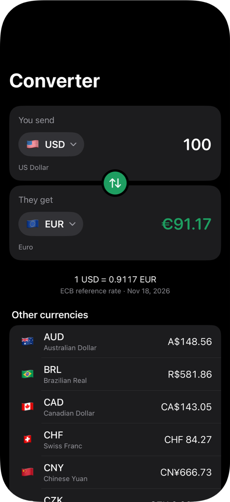

# Currency Converter

Мобильное приложение-конвертер валют (iOS) с собственной серверной частью.
Учебный проект: разработка с ИИ-агентом, ход работы задокументирован в
[PROMPTS.md](PROMPTS.md), [REFLECTION.md](REFLECTION.md) и [.agent/](.agent).

**Тип проекта:** мобильное приложение с серверной частью (клиент-сервер, REST API).

## Возможности

- Конвертация между ~30 валютами по референсным курсам ЕЦБ
- Смена валют местами, поиск валюты по названию или ISO-коду
- Сумма сразу во всех остальных валютах; тап по строке делает валюту целевой
- Работа офлайн с последними загруженными курсами, pull-to-refresh
- Запоминание последней суммы и пары валют
- Ввод суммы с учётом локали: `1 234,5`, `1,234.5`, `1.234,5`

## Стек

| Часть | Технологии |
|---|---|
| iOS-клиент | Swift 6 (strict concurrency), SwiftUI, Observation, iOS 17+, XcodeGen, Swift Testing |
| Сервер | Swift 6, Vapor 4, Fluent + SQLite, REST API с ETag/Cache-Control, обновление курсов по расписанию |
| Инфраструктура | Docker (multistage: `swift:6.4-noble` → `ubuntu:noble`), Docker Compose с healthcheck и volume для БД |

Целевая схема: приложение обращается **только к нашему серверу**, сервер сам забирает курсы
у внешнего источника (Frankfurter / ЕЦБ) и хранит их в SQLite.
Во внешние API приложение не ходит: единственный адрес в нём — наш сервер.
Подробнее — [docs/architecture.md](docs/architecture.md).

## Структура

```
.
├── README.md, PROMPTS.md, REFLECTION.md
├── Package.swift                манифест SwiftPM сервера
├── src/
│   ├── ios/                     iOS-клиент
│   │   ├── project.yml          спецификация XcodeGen (.xcodeproj не коммитится)
│   │   └── CurrencyConverter/
│   │       ├── CurrencyConverterApp.swift   точка входа
│   │       ├── components/      SwiftUI-экраны и view
│   │       ├── services/        работа с API и кэшем
│   │       ├── models/          модели данных
│   │       ├── utils/           вспомогательные функции
│   │       ├── styles/          цвета, шрифты, размеры (Theme)
│   │       ├── resources/       Assets.xcassets
│   │       └── preview/         тестовые данные для #Preview (только Debug)
│   └── server/App/              сервер: entrypoint, controllers/, services/, models/, migrations/, utils/
├── tests/
│   ├── ios/                     unit-тесты клиента (Swift Testing)
│   └── server/                  тесты сервера (Swift Testing)
├── Dockerfile                   сборка образа сервера (multistage)
├── docker-compose.yml           сервер + volume с базой + healthcheck
├── scripts/verify-docker.sh     сквозная проверка Docker Compose
├── docs/
│   ├── architecture.md          схема компонентов
│   └── screenshots/             скриншоты
└── .agent/                      артефакты работы с ИИ-агентом
    ├── prompt-log.md            хронология запросов
    ├── errors.md                ошибки агента и их исправление
    └── config.json              настройки агента
```

**Про `package.json` / `requirements.txt`.** В Swift их роль играет манифест
SwiftPM `Package.swift`. Для сервера он лежит **в корне репозитория**:
SwiftPM не разрешает пакету ссылаться на исходники вне своей папки, а тесты по
шаблону лежат в `tests/server`, поэтому корень — единственное место, откуда
видны и `src/server`, и `tests/server`. У iOS-клиента сторонних зависимостей нет,
его настройки сборки описаны в `src/ios/project.yml`. Отдельный `requirements.txt`
(формат Python) в проекте не нужен.

## Запуск

### iOS-клиент

Нужны Xcode 16+ и XcodeGen.

```bash
brew install xcodegen
cd src/ios
xcodegen generate
open CurrencyConverter.xcodeproj
```

Приложение берёт данные только с нашего сервера: сначала запустите его (см. «Сервер» ниже).
Адрес задаёт build setting `API_BASE_URL` в `project.yml` (по умолчанию `http://127.0.0.1:8080` —
симулятор видит сервер на Mac). Для телефона укажите адрес Mac в локальной сети или передайте
при запуске аргумент `-APIBaseURL http://<ip>:8080`.

`.xcodeproj` генерируется из `project.yml` — перегенерируйте его после `git pull` и
после добавления или удаления файлов.

Тесты — в Xcode (⌘U) или из `src/ios`:

```bash
xcodebuild test -project CurrencyConverter.xcodeproj -scheme CurrencyConverter -destination 'platform=iOS Simulator,name=iPhone 17 Pro'
```

### Сервер

Нужен Swift 6 (Xcode 16+ на macOS или Swift toolchain на Linux). Из корня репозитория:

```bash
swift run App serve
```

При первом запуске сервер создаёт `data/rates.sqlite`, загружает курсы за последний год
и дальше обновляет их сам по будням после публикации ЕЦБ. В логе это выглядит так:

```text
[ INFO ] Sync (startup) started: backfill 2025-11-18...2026-11-18
[ INFO ] Stored 30 currencies
[ INFO ] Sync (startup) finished: backfill added 256 days (2025-11-18...2026-11-18), 7454 rates; 256 days in DB, latest 2026-11-18
[ INFO ] Next sync at 2026-11-19 16:15 Europe/Berlin
```

После перезапуска сервер догружает только пропущенные дни.

| Переменная | По умолчанию | |
|---|---|---|
| `DATABASE_PATH` | `data/rates.sqlite` | файл SQLite |
| `BACKFILL_DAYS` | `365` | глубина истории при первом запуске |
| `SYNC_TIME` | `16:15` | первая попытка обновления, Europe/Berlin |
| `SYNC_ENABLED` | `true` | фоновое обновление курсов |
| `UPSTREAM_BASE_URL` | `https://api.frankfurter.dev/v1/` | источник курсов |
| `HOST`, `PORT` | `127.0.0.1`, `8080` | |

Тесты сервера:

```bash
swift test
```

### REST API

Полное описание — [docs/architecture.md](docs/architecture.md#3-rest-api). Примеры на живом сервере:

```bash
curl -s http://127.0.0.1:8080/health
```
```json
{"lastSync":{"datesAdded":0,"finishedAt":"2026-11-18T17:51:48Z","startedAt":"2026-11-18T17:51:48Z","status":"no_new_data","trigger":"startup"},"latestRateDate":"2026-11-18","nextSyncAt":"2026-11-19T15:15:00Z","status":"ok","storedDays":256,"syncInProgress":false}
```

```bash
curl -s "http://127.0.0.1:8080/rates?base=USD"                      # курсы к USD на последнюю дату
curl -s "http://127.0.0.1:8080/rates?date=2026-11-15"               # воскресенье → курсы за пятницу 13-го
curl -s "http://127.0.0.1:8080/timeseries?base=USD&symbols=GBP&start=2026-11-10&end=2026-11-18"
curl -s http://127.0.0.1:8080/currencies
```

Повторный запрос с `ETag` из прошлого ответа возвращает `304` без тела:

```bash
curl -si -H 'If-None-Match: "8cbb9eb254492c79ecd32dccb73f5960"' http://127.0.0.1:8080/rates
```
```text
HTTP/1.1 304 Not Modified
etag: "8cbb9eb254492c79ecd32dccb73f5960"
cache-control: public, max-age=3600
```

Ошибки в едином формате:

```json
{"error":{"code":"unknown_currency","message":"Currency 'XYZ' is not supported."}}
```

### Docker Compose

```bash
docker compose up -d --build
docker compose ps          # STATUS: health: starting → healthy
curl -s localhost:8080/health
```

- При первом запуске сервер загружает курсы за год. Пока их нет, `/health` отвечает `503`,
  и контейнер в статусе `starting`; после бэкфилла — `healthy`.
- База лежит в именованном volume `rates-data` и переживает `docker compose down` / `up`.
  Удаляет её только `docker compose down -v`.
- Порт на хосте меняется переменной `SERVER_PORT` (по умолчанию `8080`).

Сквозная проверка — свежий старт, ожидание `healthy`, `down`/`up`, сохранность базы —
одним скриптом. Он работает в отдельном compose-проекте со своим volume и портом `18080`,
рабочие данные не трогает и убирает за собой:

```bash
scripts/verify-docker.sh
```

> **Статус проверки:** на машине разработки Docker не установлен, поэтому `docker compose up`
> ещё не запускался. Проверено без Docker: release-сборка, запуск бинарника с командой и
> переменными окружения контейнера (`serve --env production`, `HOST=0.0.0.0`, `LOG_LEVEL=info`),
> команда healthcheck (`503` во время бэкфилла → `200`), завершение по `SIGTERM`, сохранность
> базы после перезапуска. Сборка под Linux и сам Compose ждут запуска `scripts/verify-docker.sh`.

## Скриншоты

Приложение в симуляторе с локальным сервером:

| Холодный старт: курсы с сервера | Сервер выключен: курсы из кэша |
|---|---|
|  |  |

Превью SwiftUI:

| Светлая тема | Тёмная тема |
|---|---|
|  |  |

Видео-демонстрация (`docs/demo.mp4`) будет добавлена позже.
