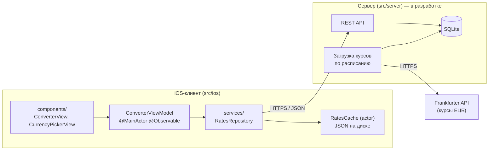

# Архитектура

## Целевая схема

Приложение обращается только к собственному серверу. Сервер по расписанию забирает
курсы у внешнего источника, хранит их в SQLite и отдаёт клиенту по REST.

Всё серверное поднимается через Docker Compose.

## Текущее состояние

Сервера пока нет: `FrankfurterClient` в клиенте ходит во внешний API напрямую.
Клиент зависит только от протокола `RatesProviding`, поэтому переход на свой сервер —
это новая реализация протокола без изменений в UI и модели экрана.

## iOS-клиент

| Слой | Папка | Что внутри |
|---|---|---|
| Точка входа | `CurrencyConverterApp.swift` | создаёт `ConverterViewModel` с боевым репозиторием |
| UI | `components/` | `ConverterView` и его части (`CurrencyCard`, `ConversionRow`, `OfflineBanner`), `CurrencyPickerView` |
| Модель экрана | `components/converter/ConverterViewModel.swift` | состояние ввода, производные значения, загрузка и обновление курсов |
| Данные | `services/` | `RatesProviding` (протокол источника), `FrankfurterClient`, `RatesCache`, `RatesRepository` |
| Модели | `models/` | `ExchangeRates` (кросс-курсы), `Currency` (название, флаг, поиск) |
| Утилиты | `utils/` | `AmountParser` (ввод суммы с учётом локали) |
| Стили | `styles/` | `Theme`: цвета, радиусы, шрифты |

### Поток данных

1. `ConverterView` при появлении вызывает `model.load()`.
2. Модель сразу показывает курсы из кэша (`RatesCache`), затем запрашивает свежие.
3. Свежие курсы сохраняются в кэш; при ошибке сети остаются старые и показывается баннер.
4. Курсы приходят одним снимком относительно EUR; любая пара считается локально как кросс-курс.

### Конкурентность

Swift 6, `SWIFT_STRICT_CONCURRENCY = complete`:
- UI-состояние изолировано на `@MainActor`
- дисковый кэш — `actor`
- модели и сервисы — `Sendable`-значения
