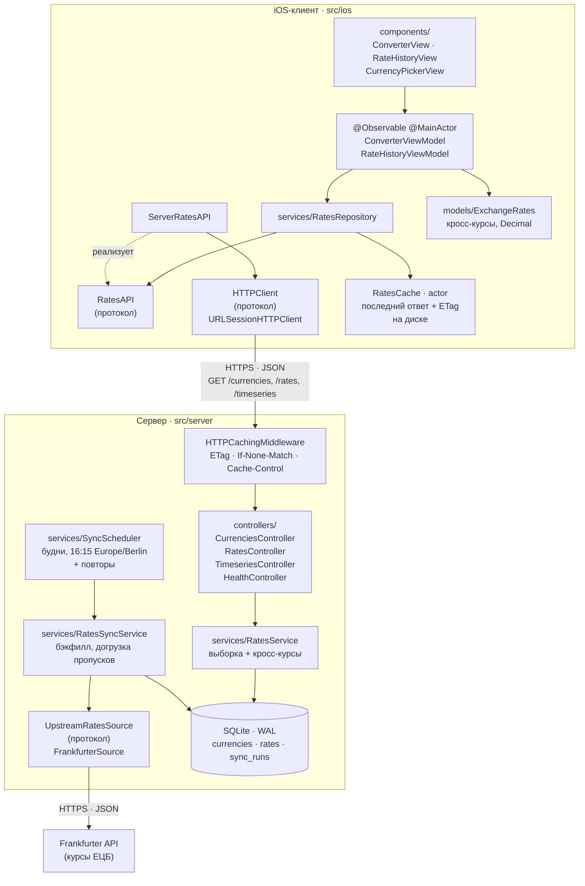
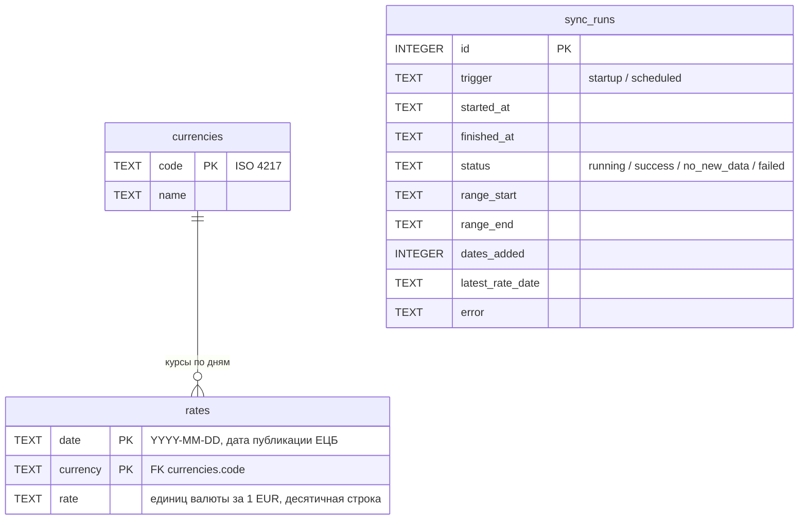
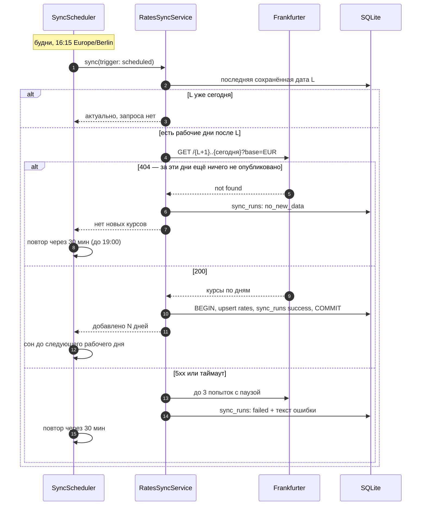
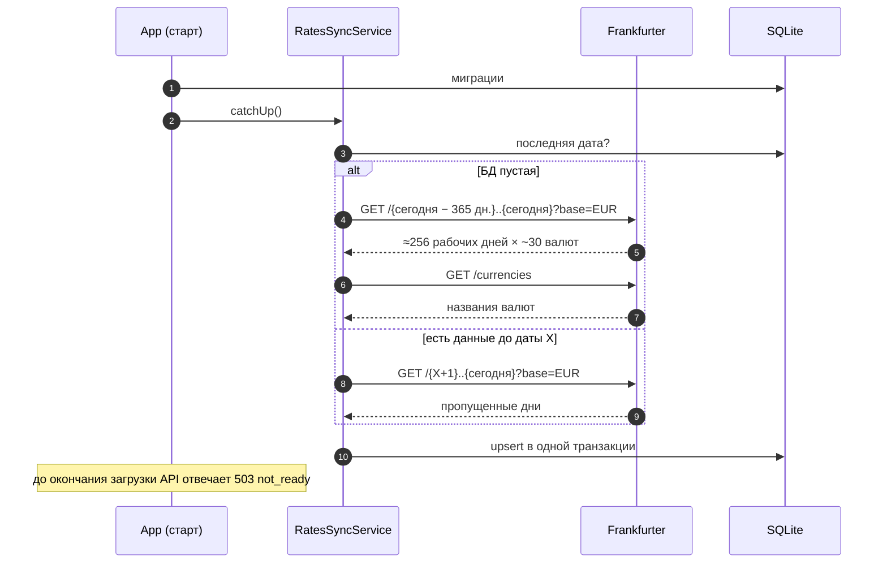
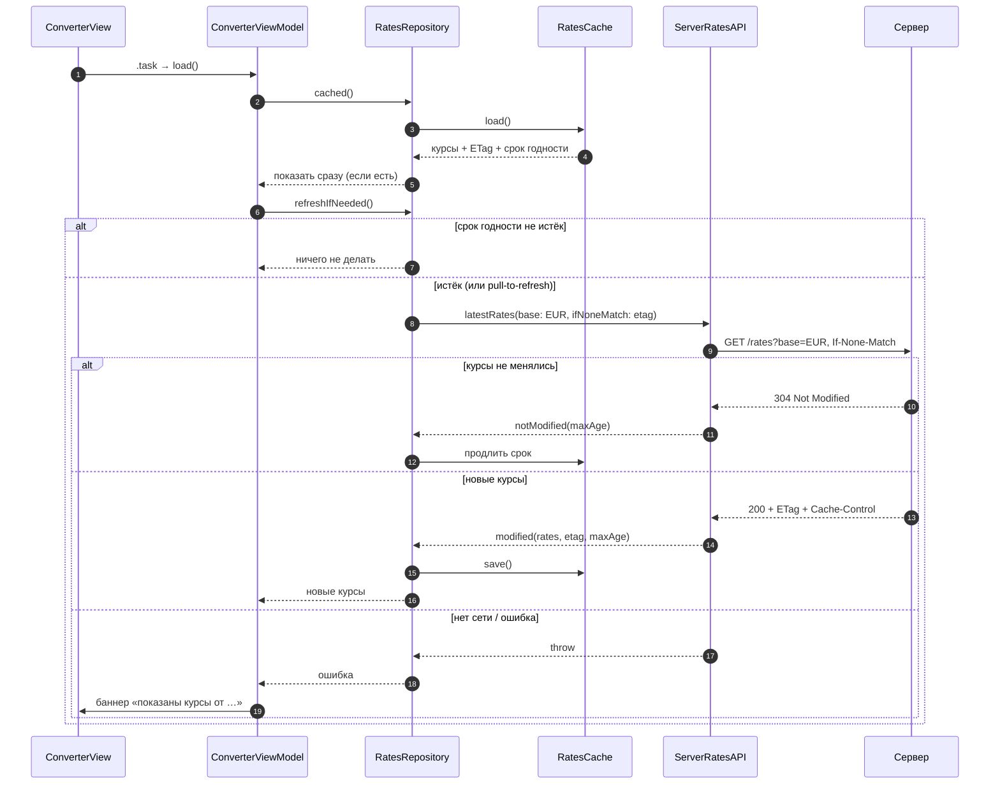
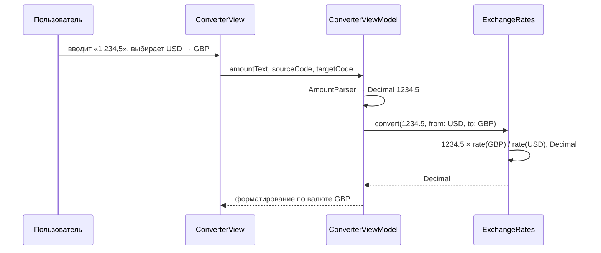
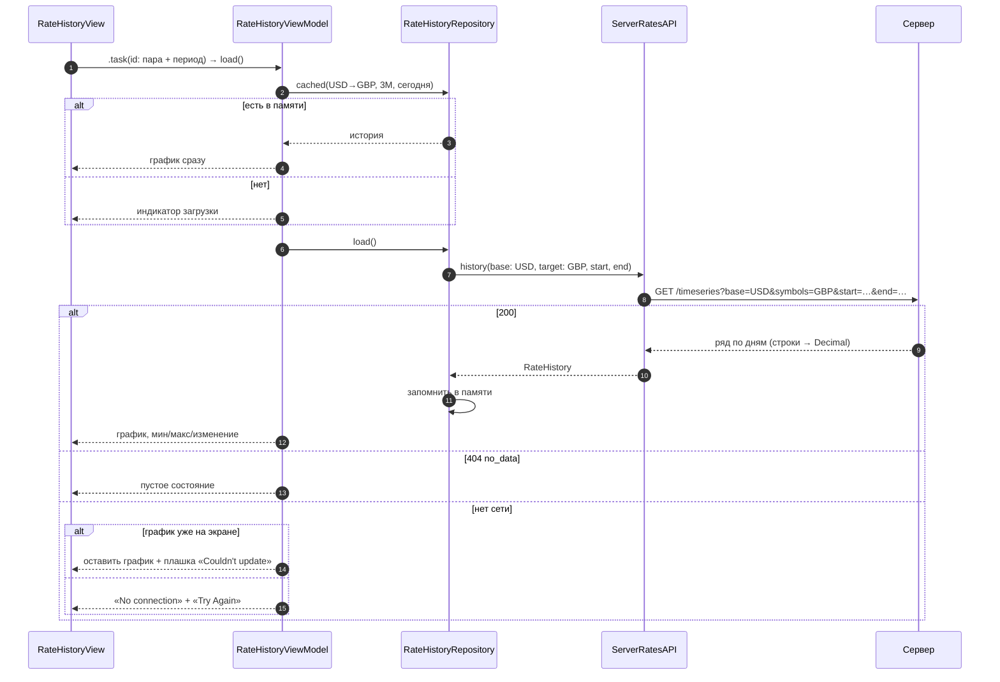

# Архитектура

Конвертер валют: iOS-приложение и собственный сервер на Swift.
Приложение обращается **только к нашему серверу**. Внешний источник курсов знает только сервер:
он по расписанию забирает курсы, хранит историю в SQLite и отдаёт её по REST.

- [1. Компоненты](#1-компоненты)
- [2. Где считать кросс-курсы](#2-где-считать-кросс-курсы)
- [3. REST API](#3-rest-api)
- [4. Кэширование: ETag и Cache-Control](#4-кэширование-etag-и-cache-control)
- [5. Сервер](#5-сервер)
- [6. iOS-клиент](#6-ios-клиент)
- [7. Потоки данных](#7-потоки-данных)
- [8. Развёртывание](#8-развёртывание)
- [9. Тестирование](#9-тестирование)
- [10. Текущее состояние и план](#10-текущее-состояние-и-план)

---

## 1. Компоненты



| Компонент | Ответственность |
|---|---|
| **SyncScheduler** | Будит синхронизацию в рабочие дни после публикации курсов ЕЦБ, делает повторы, при старте догружает пропуски |
| **RatesSyncService** | Забирает курсы у внешнего источника и идемпотентно записывает их в SQLite (upsert по `(date, currency)`) |
| **UpstreamRatesSource** | Протокол внешнего источника; реализация `FrankfurterSource`. Можно заменить на прямой XML ЕЦБ без изменений остального кода |
| **RatesService** | Читает курсы из БД, пересчитывает их к запрошенной базе (`Decimal`) |
| **HTTPCachingMiddleware** | Ставит `ETag` и `Cache-Control`, отвечает `304 Not Modified` на `If-None-Match` |
| **ServerRatesAPI** | Единственная точка выхода клиента в сеть; собирает запросы, обрабатывает `304`, превращает ошибки в типизированные |
| **RatesRepository** | Совмещает API и кэш: отдаёт кэш сразу, решает, нужно ли идти в сеть, сохраняет новый ответ |
| **RatesCache** | `actor`, хранит на диске последний ответ `/rates` и `/currencies` с `ETag` и сроком годности |
| **ExchangeRates** | Конвертация любой пары по снимку курсов к EUR, только `Decimal` |

---

## 2. Где считать кросс-курсы

ЕЦБ публикует курсы только к евро: `1 EUR = 1.0968 USD`, `1 EUR = 0.8329 GBP`.
Курс любой другой пары — частное двух опубликованных чисел: `USD→GBP = 0.8329 / 1.0968`.

### Варианты

| | Считать на клиенте от одной базы | Считать на сервере (`?base=`) |
|---|---|---|
| Запросов на все пары | **1** (`/rates?base=EUR`) | 1 на каждую базу |
| Офлайн | **любая из ~870 пар** по одному снимку (~1 КБ) | только пары от последней запрошенной базы |
| Кэш и `ETag` | **один ресурс в день**: одна ревалидация, почти всегда `304` | ~30 вариантов, каждый ревалидируется отдельно |
| Точность | **нет промежуточного округления**: делятся исходные числа ЕЦБ | сервер округляет кросс-курс, клиент умножает уже округлённое |
| Смена валюты в UI | **мгновенно, без сети** | запрос на каждую смену базы |
| Сложность клиента | формула деления в `ExchangeRates` (уже есть и покрыта тестами) | минимальная |
| Другие клиенты API | — | получают готовый курс к любой базе |

### Решение: гибрид — сервер умеет `base`, конвертер считает на клиенте

1. **Сервер поддерживает `?base=` во всех эндпоинтах.** API самодостаточно: им можно пользоваться
   без знания, что внутри всё хранится к евро. Кросс-курс считается в `Decimal` и округляется
   до 6 значащих цифр (ЕЦБ публикует 5, так что точность не теряется).
2. **Конвертер на iOS запрашивает `/rates?base=EUR` и считает пары сам.** Для денежных расчётов
   это и точнее (одно деление исходных чисел, без округления посередине), и дешевле (один
   кэшируемый ресурс), и работает офлайн для любой пары.
3. **История курса (`/timeseries`) считается на сервере.** Клиент запрашивает
   `base=USD&symbols=GBP` и получает один готовый ряд для графика: в 2 раза меньше данных, чем
   два ряда к евро, а округление до 6 цифр на графике незаметно — деньги по истории не считаются.

Формула кросс-курса живёт в двух местах (сервер и клиент), поэтому обе реализации проверяются
**одним набором тест-векторов** `tests/fixtures/cross-rates.json`, который читают тесты обеих сторон.

---

## 3. REST API

Базовый URL: `http://localhost:8080` (Docker Compose). Все ответы — JSON, даты — `YYYY-MM-DD`
по календарю публикаций ЕЦБ. **Курсы передаются строками** (`"1.0968"`): так значение не проходит
через `Double` ни в одном JSON-парсере и на клиенте сразу становится `Decimal`.

### `GET /currencies`

Список валют, для которых есть курсы на последнюю дату.

Набор валют со временем меняется: например, болгарский лев (BGN) ЕЦБ публиковал до 31.12.2025,
а с 2026 года Болгария перешла на евро. Поэтому `/currencies` и `/rates` отдают только валюты,
у которых есть курс на соответствующую дату, а `/timeseries` — только дни, где курс был.

```json
{ "currencies": [ { "code": "AUD", "name": "Australian Dollar" }, { "code": "EUR", "name": "Euro" } ] }
```

### `GET /rates?base=EUR&date=2026-11-18`

| Параметр | Обязателен | По умолчанию | |
|---|---|---|---|
| `base` | нет | `EUR` | ISO 4217, должна быть в `/currencies` |
| `date` | нет | последняя дата | если на дату нет публикации (выходной, праздник) — берётся ближайшая предыдущая, фактическая дата в поле `date` |

```json
{ "base": "EUR", "date": "2026-11-18", "rates": { "GBP": "0.8329", "JPY": "174.85", "USD": "1.0968" } }
```

### `GET /timeseries?base=USD&symbols=GBP,JPY&start=2026-08-18&end=2026-11-18`

| Параметр | Обязателен | |
|---|---|---|
| `base` | нет, `EUR` | |
| `symbols` | нет, все валюты | через запятую |
| `start`, `end` | да | включительно; диапазон до 5 лет |

В ответе только рабочие дни, в которые были публикации.

```json
{
  "base": "USD", "start": "2026-08-18", "end": "2026-11-18",
  "rates": {
    "2026-08-18": { "GBP": "0.75812", "JPY": "158.21" },
    "2026-08-19": { "GBP": "0.75790", "JPY": "158.64" }
  }
}
```

### `GET /health`

Состояние данных и синхронизации: используется в healthcheck Docker Compose и на демо,
чтобы было видно, какие курсы лежат в базе и чем закончился последний синк.

```json
{
  "status": "ok",
  "latestRateDate": "2026-11-18",
  "storedDays": 256,
  "lastSync": {
    "trigger": "scheduled",
    "status": "success",
    "startedAt": "2026-11-18T15:15:00Z",
    "finishedAt": "2026-11-18T15:15:02Z",
    "datesAdded": 1
  },
  "syncInProgress": false,
  "nextSyncAt": "2026-11-19T15:15:00Z"
}
```

`lastSync` — последняя *завершённая* попытка (поле `error` появляется, только если она упала),
`syncInProgress` — идёт ли синк прямо сейчас (например, первый бэкфилл). Пустые поля не выводятся.

| `status` | HTTP | Когда |
|---|---|---|
| `ok` | 200 | курсы есть, последний синк успешный или «нет новых данных» |
| `degraded` | 200 | курсы есть, но последний синк упал (источник недоступен) — API продолжает отдавать то, что в базе |
| `not_ready` | 503 | в базе ещё нет ни одного дня (идёт первый бэкфилл) |

Healthcheck в Compose проверяет HTTP-код: контейнер «здоров», как только в базе есть курсы.
Сбой внешнего источника (`degraded`) не делает контейнер нездоровым — перезапуск сервера
источник не починит, а данные из базы по-прежнему отдаются.

### Ошибки

```json
{ "error": { "code": "unknown_currency", "message": "Currency 'XYZ' is not supported." } }
```

| Статус | `code` | Когда |
|---|---|---|
| 400 | `invalid_parameter` | неверный формат даты, `start > end`, диапазон больше 5 лет |
| 400 | `unknown_currency` | `base` или `symbols` нет в `/currencies` |
| 404 | `no_data` | нет курсов на запрошенный период (раньше начала истории) |
| 503 | `not_ready` | сервер только запущен и ещё не загрузил первые курсы |

---

## 4. Кэширование: ETag и Cache-Control

Цель — чтобы клиент не скачивал то, что у него уже есть. Курсы меняются раз в рабочий день,
а прошлые курсы не меняются никогда.

**ETag** — сильный, `"<первые 16 байт SHA-256 тела ответа в hex>"`. Считается в middleware
по готовому телу, поэтому всегда корректен и не требует ручного версионирования.
Если в запросе `If-None-Match` совпадает с ETag — ответ `304 Not Modified` без тела.

**Cache-Control** по типу данных:

| Ответ | `Cache-Control` | Почему |
|---|---|---|
| `/rates` без `date` (последние) | `public, max-age=3600` | новые курсы появляются раз в день; через час клиент ревалидирует по ETag и почти всегда получает `304` |
| `/rates?date=` в прошлом | `public, max-age=31536000, immutable` | исторические курсы не меняются |
| `/timeseries`, `end` раньше последней даты | `public, max-age=31536000, immutable` | то же |
| `/timeseries`, включает последнюю дату | `public, max-age=3600` | последний день может дописаться |
| `/currencies` | `public, max-age=86400` | список валют меняется крайне редко |
| ошибки, `/health` | `no-store` | |

**Клиент** не полагается на `URLCache` (его могут вытеснить, и тогда офлайн-режим пропадёт),
а ведёт кэш сам в `RatesCache`: хранит тело, `ETag`, время загрузки и срок годности
из `max-age`.

- Срок не истёк → в сеть не ходим.
- Срок истёк или pull-to-refresh → запрос с `If-None-Match`; `304` → продлеваем срок, тело не качаем.
- Нет сети → показываем кэш и время последнего обновления.

**Сервер к внешнему источнику** не делает лишних запросов по-другому: он знает последнюю
сохранённую дату и спрашивает только диапазон после неё (`/{дата+1}..{сегодня}`). Если сегодняшние
курсы уже в базе или в диапазоне нет рабочих дней, запроса нет вовсе.

---

## 5. Сервер

**Стек:** Swift 6, [Vapor 4](https://vapor.codes), Fluent + FluentSQLiteDriver, Swift Testing / VaporTesting.
Vapor — самый распространённый серверный фреймворк на Swift: миграции, роутинг, middleware и
тестирование из коробки.

### Структура

```
Package.swift                    манифест в корне (см. README)
src/server/App/
├── entrypoint.swift             точка входа, @main
├── configure.swift              БД, миграции, синхронизация, маршруты
├── AppConfig.swift              настройки из переменных окружения
├── routes.swift                 маршруты
├── controllers/                 Currencies-, Rates-, Timeseries-, HealthController
├── services/                    UpstreamRatesSource + FrankfurterSource, RatesStore,
│                                RatesSyncService, SyncSchedule, SyncScheduler,
│                                RatesService
├── models/                      CurrencyModel, SyncRun (Fluent), DailyRates, ответы API
├── migrations/                  CreateCurrencies, CreateRates, CreateSyncRuns
└── utils/                       RateDate, TimeOfDay, Decimal-округление, параметры запроса,
                                 APIError + APIErrorMiddleware, HTTPCachingMiddleware
tests/server/                    тесты сервера
tests/fixtures/cross-rates.json  общие тест-векторы для сервера и клиента
```

Fluent используется для миграций и моделей `currencies` и `sync_runs`. Таблица `rates` пишется
пакетными upsert'ами (`INSERT … ON CONFLICT DO UPDATE`), которых нет в модельном API Fluent,
поэтому `RatesStore` работает с ней через SQLKit на том же соединении.

### Хранилище (SQLite)



- Курсы хранятся **только к евро и ровно в том виде, в каком опубликованы**. В SQLite нет
  десятичного типа (`REAL` — это `Double`), поэтому курс хранится как `TEXT` и читается в `Decimal`.
- Индекс `(currency, date)` для выборок истории.
- Режим WAL: чтение API не блокируется во время записи синхронизации.
- `sync_runs` — журнал синхронизаций, его последняя запись видна в `/health`.

### Расписание обновления

ЕЦБ публикует курсы около 16:00 по центральноевропейскому времени в рабочие дни (кроме праздников TARGET).

1. **При старте:** если БД пустая — бэкфилл за последние `BACKFILL_DAYS` дней (по умолчанию 365)
   одним запросом к `/{start}..{end}` у Frankfurter (≈256 рабочих дней). Если не пустая — догрузка
   с последней сохранённой даты по сегодня: покрывает время, пока сервер был выключен.
2. **По будням в 16:15 Europe/Berlin** — запрос последних курсов. Время считается через
   `Calendar` с часовым поясом `Europe/Berlin`, поэтому переход на летнее время учтён.
3. **Повторы:** если последняя дата у источника ещё не сегодняшняя — повтор каждые 30 минут до 19:00.
   Если курсов так и нет, значит праздник, и следующая попытка будет в следующий рабочий день.
4. Запись идемпотентна (upsert по `(date, currency)`), в одной транзакции на синхронизацию.
5. **Проверка данных источника** до записи: даты внутри запрошенного диапазона, коды из 3 заглавных
   букв, курсы > 0, нет пустых дней. Один плохой день отклоняет весь пакет — в базу не пишется ничего,
   попытка записывается в `sync_runs` как `failed` с текстом ошибки, `/health` показывает `degraded`.
   Ответ, который не разбирается как JSON, обрабатывается так же. `5xx`, `429` и сетевые ошибки
   источника повторяются до 3 раз с паузой, `404` означает «за эти дни ещё ничего не опубликовано».

Планировщик — свой `SyncScheduler`: цикл в `Task` с `Task.sleep(until:)` до следующего запуска,
запускается и останавливается вместе с приложением (`LifecycleHandler`). Часы (`Clock`) и источник
курсов внедряются, поэтому расписание тестируется без ожидания реального времени.
Vapor Queues не используется: для запланированных задач он требует отдельного хранилища очередей
(Redis), а для одной задачи в день это лишний сервис в `docker-compose`.

### Конфигурация (переменные окружения)

| Переменная | По умолчанию | |
|---|---|---|
| `DATABASE_PATH` | `/data/rates.sqlite` | файл БД на volume |
| `UPSTREAM_BASE_URL` | `https://api.frankfurter.dev/v1/` | внешний источник |
| `BACKFILL_DAYS` | `365` | глубина истории при первом запуске |
| `SYNC_TIME` | `16:15` | время первой попытки, Europe/Berlin |
| `PORT` | `8080` | |

---

## 6. iOS-клиент

**Стек:** Swift 6 со strict concurrency, SwiftUI, Observation, Swift Charts, iOS 17+, XcodeGen,
Swift Testing. Без сторонних зависимостей.

### Принципы

- **Модели экранов — `@Observable` на `@MainActor`**: `ConverterViewModel` (ввод, выбор валют,
  результат) и `RateHistoryViewModel` (пара, период 1Н / 1М / 3М / 1Г, точки графика).
  Состояние загрузки — `enum LoadState { idle, loading, loaded, failed }`.
- **Сетевой слой за протоколами** — два уровня, оба подменяются в тестах:
  ```swift
  protocol HTTPClient: Sendable {
      func send(_ request: URLRequest) async throws -> (Data, HTTPURLResponse)
  }

  protocol RatesAPI: Sendable {
      func latestRates(base: String, ifNoneMatch etag: String?) async throws -> Conditional<ExchangeRates>
      func history(base: String, target: String, start: Date, end: Date) async throws -> RateHistory
  }

  enum Conditional<Value: Sendable>: Sendable {
      case modified(Value, etag: String?, maxAge: TimeInterval?)
      case notModified(maxAge: TimeInterval?)
  }
  ```
  `RatesAPI` мокается в тестах моделей экранов, `HTTPClient` — в тестах `ServerRatesAPI`
  (сборка URL, заголовки, обработка `304` и ошибок).
- **Деньги — только `Decimal`.** Сумма вводится через `AmountParser`, курсы приходят строками
  и разбираются `Decimal(string:locale: en_US_POSIX)`, конвертация — `Decimal`, вывод —
  `Decimal.FormatStyle.Currency`. `Double` встречается в одном месте: координаты точек на графике
  Swift Charts, потому что Charts строит оси только по `Double`. Подписи на графике
  форматируются из исходных `Decimal`.
- **Офлайн-кэш последнего ответа** — `RatesCache` (`actor`, `Caches/rates-cache-v2.json`): последний
  `/rates?base=EUR` (курсы строками), его `ETag`, когда скачан (`fetchedAt`), когда сервер последний раз
  подтвердил (`validatedAt`) и до какого момента не спрашивать (`expiresAt` = сейчас + `max-age`).
  `RatesRepository` решает, идти ли в сеть:

  | Ситуация | Запрос | Результат |
  |---|---|---|
  | кэш свежий (запуск, возврат из фона) | нет | курсы из кэша |
  | кэш истёк или pull-to-refresh | `GET /rates?base=EUR` + `If-None-Match` | `304` — продлить срок; `200` — заменить кэш |
  | первый запуск, кэша нет | `GET /rates?base=EUR` без `If-None-Match` | `200` — сохранить |
  | сервер недоступен | был | ошибка; на экране кэш и плашка «показаны курсы, обновлённые …» |

  `URLSession` работает без `URLCache`, чтобы системный кэш не отвечал вместо нашего и не вытеснял
  офлайн-копию. История курса будет кэшироваться только в памяти.
- **Адрес сервера** — build setting `API_BASE_URL` → ключ `APIBaseURL` в Info.plist (по умолчанию
  `http://127.0.0.1:8080`: симулятор видит сервер на Mac), можно переопределить аргументом запуска
  `-APIBaseURL`. ATS разрешает HTTP только к локальным адресам (`NSAllowsLocalNetworking`);
  других адресов в приложении нет. Для телефона — IP Mac в локальной сети.
- **Настройки пользователя** — `PreferencesStore` над `UserDefaults`: сумма, пара валют, избранное
  (упорядоченный список кодов) и недавние (до 5, свежие первыми). Модель экрана пишет каждое изменение
  сразу, поэтому после перезапуска всё на месте. При первом запуске избранное — EUR, GBP, JPY, CHF;
  опустошённое пользователем избранное остаётся пустым.
- **Список и названия валют** — из снимка курсов (`/rates` содержит все коды), названия —
  локализованные `Locale.localizedString(forCurrencyCode:)`. Отдельный запрос `/currencies`
  клиенту не нужен; эндпоинт остаётся для других клиентов API.

### Экраны

| Экран | Модель | Данные |
|---|---|---|
| Конвертер + избранное | `ConverterViewModel` | `/rates?base=EUR` (кэш), расчёт на клиенте; избранное и недавние — `PreferencesStore` |
| Выбор валюты | — (список + поиск) | коды из снимка `/rates`, названия из `Locale`; секция «Recent» |
| История курса | `RateHistoryViewModel` | `/timeseries?base=&symbols=` для одной пары, кэш в памяти на сессию |

### Локализация, тёмная тема, Dynamic Type

- **Строки** — String Catalog `resources/Localizable.xcstrings` (en — исходный язык, ru — перевод),
  название на домашнем экране — `resources/InfoPlist.xcstrings` («Валюты»). Компилятор сам извлекает
  строки из `Text("…")`, `String(localized:)` и `LocalizedStringResource`; строки без слов (коды, числа)
  выводятся через `Text(verbatim:)`, чтобы не засорять каталог. Полнота перевода проверяется командой
  `xcodebuild -exportLocalizations -exportLanguage ru` (все строки должны иметь перевод) и тестами
  `LocalizationTests`. Числа, даты и названия валют форматируются по локали пользователя.
- **Тёмная тема** — только системные семантические цвета (`Theme`), отдельных тёмных ассетов нет.
- **Dynamic Type** — на размерах accessibility (AX1–AX5) строки, которые не помещаются рядом,
  перестраиваются в столбик: карточки валют, строки избранного, заголовок «Избранное», шапка и плитки
  истории, строки пикера. Значки в кругах фиксированного размера и подписи осей графика ограничены
  размером `xxLarge`/`xxxLarge` (у кнопки смены валют есть Large Content Viewer). Результат конвертации
  выводится в полный размер, если помещается, и ужимается только для очень длинных чисел (`ViewThatFits`).
- **Хаптик** — средний удар при смене валют местами (главный экран и экран истории), выбор точки
  на графике — хаптик выбора.

### Главный экран и избранное

Главный экран — `List`, а не `ScrollView`: свайп для удаления и перетаскивание для порядка есть
только у `List`. Сверху конвертер пары и карточка курса (вход в историю), ниже — «Favorites»:

| Действие | Как |
|---|---|
| Добавить | «+» в заголовке → пикер в режиме избранного: галочки, можно отметить несколько, «Done» |
| Удалить | свайп влево, «Edit» → «−», или контекстное меню → «Remove from Favorites» |
| Порядок | «Edit» (или контекстное меню → «Reorder») → перетаскивание за ручки |
| Сделать целевой | тап по строке |

Перетаскивание без режима Edit не используется: долгое нажатие на строке открывает контекстное
меню (история, порядок, удаление), и система отдаёт жест меню, а не перетаскиванию.

Пикер показывает сверху «Recent» — последние 5 выбранных валют (пара и добавленные в избранное).
Пока пикер открыт, этот список зафиксирован, чтобы строки не сдвигались под пальцем.

### Экран истории курса

**Как открыть.** Главный путь — карточка курса пары на главном экране (`1 USD = 0.9117 EUR · History ›`):
это ровно то число, историю которого хочется увидеть, поэтому вход там, где пользователь уже смотрит.
Второй — долгое нажатие на любую валюту в «Favorites» → «Rate history» (история
от исходной валюты к выбранной). Экран открывается push-навигацией, внутри можно поменять пару местами.

**Что на экране:** текущий курс и изменение за период, переключатель 1W / 1M / 3M / 1Y,
график (линия + заливка) с выделением по драгу — вертикальная линия, точка и подсказка
со значением на ближайший день публикации, — плитки «Low / High / Change». Все расчёты в `Decimal`;
`Double` — только координаты для Swift Charts. На недельном графике отмечены точки дней публикации,
чтобы плавная линия через выходные не выглядела как данные.

**Состояния:**

| Состояние | Когда | Что видно |
|---|---|---|
| Загрузка | первый запрос периода | индикатор на месте графика (повторная загрузка того же периода график не скрывает) |
| График | ≥ 2 дней с курсом | график, выделение, статистика |
| Пусто | сервер ответил `no_data` или день всего один | «No data for this period» и причина (например, валюту перестали публиковать) |
| Нет сети, данных нет | сетевая ошибка, период ещё не загружался | «No connection» + «Try Again» |
| Нет сети, данные в памяти | сетевая ошибка, период уже загружался в этой сессии | график из памяти и плашка «Couldn't update rates» |
| Ошибка сервера | любой другой ответ, например `503 not_ready` | текст ошибки с сервера + «Try Again» |

---

## 7. Потоки данных

### 7.1 Ежедневное обновление курсов на сервере



### 7.2 Первый запуск сервера



### 7.3 Запуск приложения и обновление курсов



### 7.4 Конвертация (без сети)



### 7.5 История курса



---

## 8. Развёртывание

Сервер запускается через Docker Compose из корня репозитория ([docker-compose.yml](../docker-compose.yml)):

```yaml
services:
  server:
    build: .
    ports: ["${SERVER_PORT:-8080}:8080"]
    environment:
      DATABASE_PATH: /data/rates.sqlite
      BACKFILL_DAYS: "365"
      LOG_LEVEL: info              # в production Vapor по умолчанию пишет только notice
    volumes:
      - rates-data:/data           # БД переживает down/up; удаляет только down -v
    healthcheck:
      test: ["CMD", "curl", "-fsS", "-o", "/dev/null", "http://localhost:8080/health"]
      start_period: 120s           # первый бэкфилл
      start_interval: 3s
    restart: unless-stopped
volumes:
  rates-data:
```

[Dockerfile](../Dockerfile) — два этапа:

| Этап | Образ | Что делает |
|---|---|---|
| build | `swift:6.4-noble` | `swift package resolve` отдельным слоем (кэшируется, пока не меняется `Package.*`), затем `swift build -c release --static-swift-stdlib` |
| run | `ubuntu:noble` | только бинарник; рантайм Swift вместе с Foundation слинкован статически, тулчейн не нужен. Пакеты: `ca-certificates` (HTTPS к источнику), `tzdata` (расписание по Europe/Berlin), `curl` (healthcheck), `libjemalloc2` |

Сервер в контейнере работает от непривилегированного пользователя `vapor`, папка `/data`
принадлежит ему. `docker stop` шлёт `SIGTERM`, и Vapor завершается сразу, не дожидаясь `SIGKILL`.

Healthcheck использует HTTP-код `/health`: `503 not_ready`, пока в базе нет курсов, затем `200`.
Сбой источника (`degraded`) контейнер не роняет — см. раздел 3.

`scripts/verify-docker.sh` проверяет всё это сквозным сценарием в отдельном compose-проекте.
iOS-клиент собирается в Xcode, в Docker он не входит.

## 9. Тестирование

| Где | Что | Как |
|---|---|---|
| `tests/server` | кросс-курсы и округление | общие векторы `tests/fixtures/cross-rates.json` |
| | синхронизация: бэкфилл, догрузка, повторы, праздники | заглушка `UpstreamRatesSource`, SQLite в памяти |
| | расписание: будни, 16:15 Berlin, переход на летнее время | внедрённые часы |
| | эндпоинты: ответы, ошибки, `ETag` / `304`, `Cache-Control` | VaporTesting, SQLite в памяти |
| | сбои источника: мусор вместо JSON, неправдоподобные курсы, `5xx` с повторами, `404` | заглушка HTTP-клиента Vapor |
| | цикл планировщика: выходные через переход на летнее время, пасхальные праздники | подменённые часы и `sleep` |
| `tests/ios` | кросс-курсы | те же общие векторы |
| | `ServerRatesAPI`: URL, `If-None-Match`, `304`, ошибки, разбор строк в `Decimal` | мок `HTTPClient` |
| | модели экранов: кэш → сеть, офлайн, срок годности, период истории | мок `RatesAPI` |
| | разбор суммы | `AmountParser` (уже есть) |

---

## 10. Текущее состояние и план

**Сейчас:**
- Сервер: хранилище, синхронизация с бэкфиллом и догрузкой, планировщик (шаг 1), REST API
  `/currencies`, `/rates`, `/timeseries`, `/health` с ETag/304 и Cache-Control, единый формат ошибок
  (шаг 2) — готово, 52 теста.
- Docker (шаг 3): `Dockerfile`, `docker-compose.yml` и скрипт проверки написаны; запуск в Docker
  ещё не проверен — на машине разработки Docker не установлен.
- iOS-клиент (шаг 4) ходит только на наш сервер: `ServerRatesAPI`, кэш с `ETag` и сроком годности,
  41 тест; проверено в симуляторе — холодный старт (`200`), запуск при выключенном сервере
  (курсы из кэша без запроса, при обновлении — плашка), обновление после включения (`304`).
- Экран истории курса (шаг 5): Swift Charts, 4 периода, выделение драгом, мин/макс/изменение, пустое
  и офлайн-состояния; проверено в симуляторе на реальных данных сервера.
- Избранное на главном экране и недавние в пикере, сохранение настроек между запусками.
- Русская локализация (String Catalog), тёмная тема и Dynamic Type до AX5 проверены превью и в симуляторе;
  75 iOS-тестов.

**План:**

1. ~~Сервер: `Package.swift`, Vapor, миграции SQLite, `RatesSyncService` с бэкфиллом, `SyncScheduler`.~~ Готово.
2. ~~Эндпоинты `/currencies`, `/rates`, `/timeseries`, `/health`, `HTTPCachingMiddleware`, тесты.~~ Готово.
3. `Dockerfile` и `docker-compose.yml`, проверка `docker compose up`. Файлы готовы, проверка ждёт Docker (`scripts/verify-docker.sh`).
4. ~~Клиент: `HTTPClient` + `ServerRatesAPI`, кэш с `ETag` и сроком годности, удаление `FrankfurterClient`.~~ Готово.
5. ~~Клиент: экран истории курса на Swift Charts.~~ Готово.
6. Общие тест-векторы кросс-курсов, скриншоты и видео работающего приложения.
